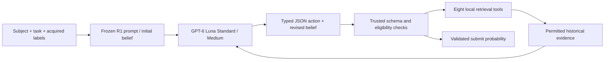

# PAIEC R1: Audited Bayesian Linguistic Evaluation

**Frozen GPT-6 Luna Standard/Medium R1 source, offline tests, and scientific analysis material.**
Developed by **Karim Ghandour** for the NeurIPS 2026 Predictive AI Evaluation Competition.

This project studies forecasting an AI system's success on a particular task. It
adapts the organizer-provided Bayesian Linguistic Evaluator (BLE), credited to
[Stanford AIMS Foundations](https://github.com/aims-foundations/paiec_baseline), with
audited historical evidence, structured beliefs and a trusted retrieval coordinator.
BLE is upstream work. This release does not claim invention of BLE or a causal
improvement attributable solely to retrieval.

The competition candidate is **R1 Medium**. The acquisition ledger, factor model
and xhigh experiments are retained as research results, not deployed alternatives.
No private submission ZIP, API credential, database, task outcomes, model weights
or personal Codex sessions are included.

## Architecture



Each forecast has fresh conversational state. A forecast permits five scientific
actions including submission; the fifth action is submit-only. The Python
coordinator executes retrieval, enforces source exclusions and validates probabilities.
Luna's belief preceding a retrieval reflects evidence already seen; the next action
may revise it. Retrieval text is evidence, never authority to change the protocol.

The transport uses the official Responses endpoint, typed JSON actions (not native
function calling), and exact opaque reasoning-item continuation. An explicit,
logged Beta(4,4) emergency fallback handles forecast failures. **Fallback is not a
successful R1 forecast and is not offered as a separate competition candidate.**

## Quick start — no inference or downloads

Python 3.12 is the tested version. From a clean checkout:

```sh
python3.12 -m venv .venv
source .venv/bin/activate
python -m pip install -r requirements-dev.txt
python -m pip install --no-deps --no-build-isolation -e .
python scripts/check_source.py
python scripts/offline_smoke.py
python -m unittest discover -s tests -v
python scripts/verify_results.py
python scripts/prepare_data.py --family algotune
python scripts/scan_release.py
```

Dependency installation requires internet access; **the tests and result checks
require neither an API key nor model weights, and make no paid calls**. Smoke
tests use explicitly invented fixtures and a mocked Responses transport. They
exercise all six budgets and all eight tools but do not measure predictive accuracy.
Four inherited tests are explicitly skipped because their private records are not
redistributed. Test outcomes and limitations are in [the release report](RELEASE_REVIEW.md).

Requirements are the frozen local research versions, not a claim that arbitrary
future dependency versions preserve numerical or model behavior. Full semantic
retrieval requires the separately obtained pinned MiniLM encoder.

## Actual source and data readiness

`submission/` contains **34 byte-identical whitelisted members** of the selected
compact candidate. Its source/hash manifest is [here](artifacts/manifests/selected_source.json).
There is no replacement prompt or newly designed agent.

The actual entry point is `submission/model.py`:

```python
predict(input: list[dict], labeled: list = None) -> float
```

Real R1 forecasting requires a separately authorized **exact derived asset bundle**
and private configuration. Directly importing the root model before installing that
bundle fails closed at asset hydration. The offline smoke test explicitly injects
synthetic assets/transport; it does not conceal this dependency.

The pinned-data preparation command above only prints an inventory. Downloading
official source files requires explicit flags, source-term acknowledgment and a
byte limit. The source-file inventory alone cannot regenerate the withheld frozen
protected-input manifest. See [data provenance](docs/data_provenance.md) and
[reproduction instructions](docs/reproducibility.md) before enabling any inference.

## Frozen findings

| Experiment | Result | Interpretation |
|---|---|---|
| Audited BLE confirmation | A0 0.203883; R1 initial 0.172116; R1 final **0.153728** Brier | 32 fresh source questions, four previously used families, budgets 0/7; historical **Codex CLI**, not hosted API |
| Ledger extension | Budget-seven gain +0.014907; clustered interval includes zero and family-regression gate fails | **RETAIN R1** |
| Rank-16 factor transfer | AlgoTune→EDIT: baseline 0.272994, factor 0.340420; reverse: 0.216085, 0.283372 | No strict cross-family improvement |
| Luna xhigh historical pilot | Medium 0.254777; xhigh 0.262933 | No broad advantage; 31 completed matched units, one missing |

These are different panels and estimands. The original confirmation uses an equal
subject/family/budget-cell macro; ledger/xhigh use equal-family means of those cells.
They are not all one pooled score, nor official six-budget Brier ALC. Raw A0 versus
final R1 improvement combines initial-prompt differences (+0.031767) and subsequent
revision (+0.018388); it does not isolate retrieval causally. One confirmation family
regressed. Development proceeded under a documented amended rule after the original
strict development gates failed. See [results and limitations](docs/experimental_results.md).

`verify_results.py` numerically reproduces released **aggregate point estimates**.
It cannot independently recreate item-level losses or cluster intervals without
the withheld records. Generic original scorers/bootstrap functions and a local
authorized-record scoring command are included.

## Layout

- `submission/`: exact frozen inference source, schemas, blank configuration template.
- `experiments/`: protocols, reference results, aggregate cells, ledger and factor methods.
- `analysis/`: original scoring/cluster-bootstrap functions and separately labeled ALC.
- `tests/`: inherited regressions and invented public fixtures.
- `scripts/`: offline smoke, source/result checks, pinned source download, private asset checks and release scan.
- `artifacts/manifests/`: revision/hash provenance and explicit data availability.
- `docs/`: methodology, API migration, data, reproduction and publication instructions.

## Competition deployment

The selected compact ZIP SHA-256 is
`414cc74f858235eb27614b6388adb767d1a54d24a5c150e4afc93730ef30df51`.
The public repository is **not that private ZIP** and cannot be uploaded unchanged
as a self-contained evidence-enabled submission. The private deployment includes
licensed retrieval assets, a private key and spend controls. Source equivalence does
not establish hosted completion, a hidden-test score, or API reproduction of 0.153728.
[API migration](docs/api_migration.md) explains the distinction.

## Attribution and license

MIT for this code, retaining the original PAIEC Predictor Baselines contributors'
notice. See [LICENSE](LICENSE) and [THIRD_PARTY_NOTICES.md](THIRD_PARTY_NOTICES.md).
This license does not relicense Measurement DB, benchmark sources, model weights,
provider services or research records. All dependencies remain under their own terms.
No institutional affiliation, contact address or endorsement is asserted.

Publication is pending maintainer authorization. `CITATION.cff` describes the planned
v1.0.0 code release; no public URL or DOI is claimed before publication. Prefer the
published commit and immutable archival release when citing it.
