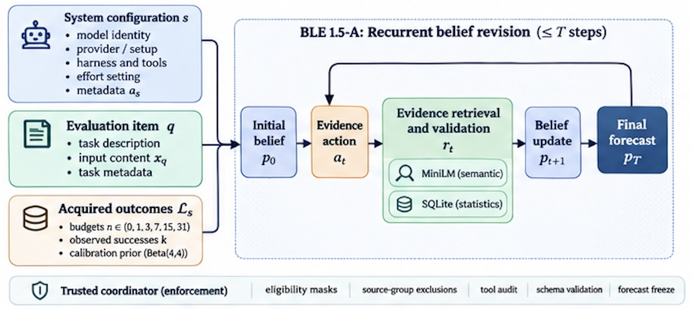

# PAIEC — BLE 1.5-A

[**Reproduce BLE 1.5-A — Source, Experiments & Reviewer Instructions**](https://github.com/KarimGhandour/PAIEC-BLE15A-Reproduction)

**Audited belief revision for predicting AI system performance**

**Official formative Brier ALC 0.1590607804 · Codabench #1032237 · 9 groups · 489 evaluated pairs · 6 budgets**

PAIEC asks whether a particular AI system will solve a particular task, without
running that system on the task. BLE starts with a model-conditioned belief,
retrieves admissible historical evidence, and revises the probability through a
bounded reasoning loop. [AIMS Foundations](https://github.com/aims-foundations/paiec_baseline)
introduced the original Bayesian Linguistic Evaluator. Our work covers its
implementation, evidence auditing, controlled experimental analysis and hosted deployment.

| Start here | What you will find |
|---|---|
| **[1. Read the executed notebook](notebooks/01_BLE_1_5A_Explained.ipynb)** | Explanation, working code, saved figures and checked results on GitHub |
| **[2. View the rendered notebook](https://nbviewer.org/github/KarimGhandour/PAIEC-code-submission/blob/v1.5.0-rc.1/notebooks/01_BLE_1_5A_Explained.ipynb)** | Browser presentation through nbviewer, pinned to the published release |
| **[3. Explore scored BLE 1.5-A](hosted-ble15a/)** | Sanitized source of the scored Standard/Medium implementation |
| **[4. Reproduce the permitted experiments](docs/reproduction.md)** | Offline walkthrough, source checks and conditional runtime reconstruction |
| **[5. Read the technical report](paper/PAIEC_BLE_NeurIPS2026_Reconstructed.pdf)** | Approved manuscript snapshot bundled with the release |
| **[6. Download the versioned public release](https://github.com/KarimGhandour/PAIEC-code-submission/releases/tag/v1.5.0-rc.1)** | `v1.5.0-rc.1`, its source and audited public ZIP |



*Approved manuscript illustration. The [scored controller and Completion policy](docs/architecture.md)
document the runtime bounds used by BLE 1.5-A.*

## Research question and results

The predictor returns the probability that the specified subject succeeds on the
target item. Codabench evaluates those probabilities against binary outcomes,
using equal-group Brier area under the learning curve across acquisition budgets
**0, 1, 3, 7, 15 and 31**. Lower loss is better.

| Evaluation | Recorded result | Scope |
|---|---|---|
| **Official hosted BLE 1.5-A** | **0.1590607804 Brier ALC** | #1032237, nine subject–benchmark groups, 489 distinct pairs, six budgets |
| Controlled public research R1 | **0.203883 → 0.153728 mean Brier** | Direct Luna versus final R1 on a frozen paired panel of 32 questions at budgets 0 and 7 |

These evaluations use different samples and aggregation. The public comparison
does not provide a matched baseline for the hosted score. The public result
supports a paired improvement on that panel, with variation across families.
It does not isolate retrieval's causal effect.

[Hosted aggregates](results/hosted_ble15a_aggregates/) ·
[Public research evidence](experiments/ble_audited_retrieval_002/) ·
[Scientific claims and limitations](docs/scientific_claims.md)

## How the scored predictor works

1. **Condition on the target.** The input identifies the AI system, task and
   legitimately acquired labels for the matching subject–benchmark group.
2. **Form a belief and choose an action.** GPT-6 Luna Medium/Standard returns a
   structured probability and a JSON action.
3. **Audit and retrieve evidence.** Python enforces admissibility and exclusions.
   Local MiniLM proposes semantically related records; SQLite returns permitted
   measurements and recomputes affected counts after exclusions.
4. **Revise and return a probability.** Luna receives the evidence and can update
   its belief. The Completion policy distinguishes a validated final submit,
   an earlier valid model belief retained after interruption, and an emergency readout.

The model-visible R1 prompt describes up to five actions. The scored Completion
controller accepts at most three valid actions, with at most four Responses
requests including repair and a 31-second inference window after initialization.
The [architecture](docs/architecture.md) and [reliability documentation](docs/deployment_reliability.md)
explain these bounds and their limitations.

## What this project contributes

- Evidence eligibility checks, target and source exclusions, and exact filtered
  retrieval around the organizer's BLE method.
- Auditable belief revisions and controlled comparisons on a frozen public panel.
- A bounded Responses API implementation with validated encrypted continuation,
  spending controls and explicit failure/readout distinctions.
- A scored deployment record, public source manifests and an executable teaching
  notebook that connects the implementation to the released evidence.

The notebook's miniature database and API replies are **invented demonstration
fixtures**. Its aggregate analyses use released result summaries. Its examples
exercise the actual controller and retrieval code with a mocked transport.

## Explore and run the notebook offline

The [GitHub notebook](notebooks/01_BLE_1_5A_Explained.ipynb) and
[nbviewer presentation](https://nbviewer.org/github/KarimGhandour/PAIEC-code-submission/blob/v1.5.0-rc.1/notebooks/01_BLE_1_5A_Explained.ipynb)
include the saved code outputs, diagrams and results. In nbviewer, use
**View on GitHub** to return to the source. The reviewed
[standalone HTML](notebooks/01_BLE_1_5A_Explained.html) can also be downloaded and
opened locally.

Use Python 3.12 with SQLite FTS5. Install the pinned notebook dependencies once,
then run the checks with networking disabled from the repository root.

```sh
python3.12 -m venv .venv-notebook
. .venv-notebook/bin/activate
python -m pip install -r requirements-notebook.txt
python scripts/verify_notebook.py
python scripts/verify_results.py
python scripts/validate_release.py
```

The notebook runner writes an executed copy and HTML preview under the ignored
`outputs/` directory. The default walkthrough needs no API credential, inference
calls, pretrained weights or private corpus.

## Reproduction and external dependencies

The [source-equivalence manifest](docs/release_manifest.md) maps the sanitized
runtime to scored A. [Reconstruction instructions](hosted-ble15a/README_OPENREVIEW.md)
pin the public MiniLM assets and record the hashes of the external runtime files.

**Six restricted derived data/firewall files require authorized exact copies or
an approved regeneration process that matches their recorded hashes.** A verified
independent regeneration process and public redistribution route remain unavailable.
Fully independent reproduction of the exact hosted runtime is therefore limited.
The released configuration has an empty credential map and paid inference disabled.

An earlier reconstruction using authorized local assets matched 70 of 72 scored
archive members. The documented differences are the sanitized configuration and
regenerated hash manifest. That reconstruction passed the official checker,
smoke tests and six-budget local retrieval checks with mocked API responses.

[Data provenance and licensing](docs/hosted_data_provenance.md) ·
[Reproduction guide](docs/reproduction.md)

## Scientific limitations

The formative score establishes a completed scored evaluation. It does not reveal
organizer-counted runtime, worker concurrency, per-forecast API traffic or the
fraction of forecasts finalized through native submit actions. The public panel
uses previously encountered families and does not establish generalization to
entirely unseen families. Source checks and offline demonstrations do not
regenerate the hosted score.

## Historical experiments and repository map

The earlier R1 implementation and research remain available under
[research R1](docs/research_r1_readme.md), [historical source](submission/) and
[the preserved v1.0.0-r1 release](https://github.com/KarimGhandour/PAIEC-code-submission/releases/tag/v1.0.0-r1).
The separate Fast A.2 submission #1033843 failed with `PAIEC-UNKNOWN-001`;
its exact cause is unverified. [Experiment decisions](results/decision_ledger.csv)
record the findings and limits of the other investigated variants.

| Directory | Purpose |
|---|---|
| [hosted-ble15a/](hosted-ble15a/) | Scored source, provenance and reconstruction |
| [notebooks/](notebooks/) and [examples/](examples/) | Executed walkthrough and offline fixtures |
| [figures/](figures/) and [results/](results/) | Approved artwork and released aggregate evidence |
| [docs/](docs/) | Architecture, reproduction, reliability and scientific claims |
| [experiments/](experiments/) and [submission/](submission/) | Historical R1 research and implementation |
| [scripts/](scripts/) and [tests/](tests/) | Verification tools and regression checks |

## Citation, authorship and license

The report and release are by **Karim Ghandour**. Credit **AIMS Foundations**
for the original BLE architecture and baseline. Use GitHub's **Cite this repository**
control or [CITATION.cff](CITATION.cff) to cite the versioned release.

The code is [MIT licensed](LICENSE), with upstream notices retained in
[THIRD_PARTY_NOTICES.md](THIRD_PARTY_NOTICES.md). Dataset and model licenses,
provider terms and restricted-asset access are separate.
